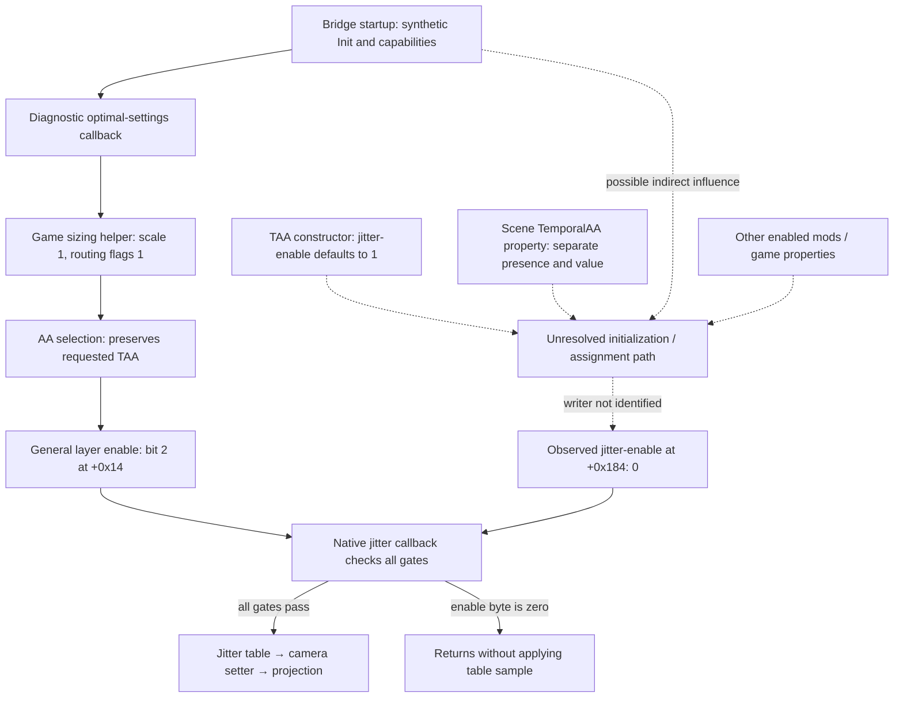

# Jitter control map and passive-provider comparison

Updated 2026-09-23: run 8164 completed the Off/TAA comparison with synthetic
provider behavior disabled. The jitter-enable byte remains 0 and stored
camera jitter remains zero in both menu and loaded gameplay. This narrows
[run 5836](jitter-pre-enable-observation.md): active bridge startup behavior
is not required for this observed state. The writer remains unresolved.
Other mods and retained observation hooks prevent calling this vanilla behavior.

The subsequent [bare-profile run 2632](jitter-bare-profile.md) repeats both
scenes without enabled MO2 mods or a detected bridge/mod-loader DLL and retains
the same zero observations. Native assignment/callback timing is the next focus.

The game is closed after a user-reported normal exit. Saved Off/TAA settings
are unchanged and the original `native-depth-probe` sidecar is restored.
`staging-control.json`, `mode.before-control.bin`, `restored.json` and
`acceptance-8164.json` preserve the control and rollback evidence privately.

## What is connected, and what remains unknown

Solid arrows describe reviewed code relationships, not proof that every node
executed in a sampled frame. Dashed arrows mark unresolved provenance or
possible influences. Run 5836 records startup callback execution and the zero
CPU values, but does not observe the native jitter callback executing.
Run 8164 observes the same zero values with the synthetic startup branch
disabled; its dashed influence is therefore not required to explain them.

The distinction between the general layer-enable bit and the separate jitter
byte matters: turning on TAA in the menu does not, in the reviewed AA-selection
function, assign the jitter byte.

| Boundary | Confirmed behavior | Limit |
| --- | --- | --- |
| Bridge Init/Populate | Publishes diagnostic availability and local optimal-settings callback before Create | Can affect startup even when menu DLSS remains Off |
| Game `0x2383EF0` | Invokes the sizing callback and converts equal 1:1 dimensions plus DLSSMode 1 to routing flags 1 | Routing metadata is not working DLAA |
| Availability check `0x4431F0` | Calls sizing with mode argument 2 and accepts nonzero routing flags | Availability is separate from menu selection and feature creation |
| AA apply `0x43DCB0` | Routing flags 2 select AA choice 3; flags 3 select choice 1; flags 1 preserve the requested choice | This function does not write layer `+0x184` |
| AA choice setter `0x2287A00` | Choices 0/1/2/3 set table bytes `+0xE9E4/+0xE9E5` to 00/10/01/11 respectively | AA apply copies their enable decisions into general layer flags |
| TAA constructor `0x2391320` | Initializes `+0x184` to 1 | Live constructor execution and later assignment are not captured |
| Jitter callback `0x23931E0` | Requires view flags, nonzero blend, type 8, layer flags and `+0x184`; then calls table `0x227DB60` and camera setter `0x228F390` | A sampled predicate is not callback-execution evidence |
| Reset/update `0x2393260` | Can reset camera jitter, update reset/general-enable state and disable sharpening | It does not assign jitter-enable `+0x184` |

The current diagnostic output is `OutWidth=Width`, `OutHeight=Height`,
`DLSSMode=1`, `Sharpness=0`. The reviewed sizing/AA-selection route therefore
does not directly explain the zero jitter byte. Indirect effects elsewhere
remain possible. The apparent clear/restore writer previously found belongs
to MotionBlurReconstructionFilter; it is not a TAA writer.

## Identity and evidence

All RVAs apply only to host version `0.0.0.0`, SHA-256
`C2EBBBD2C49F216D484E31A5219BED419EB1E5E7D206D02CBA040A3AB79D90EA`.
The decoded comparison image is
`D78611731E4A5F214E306D1D577D4782B59ADAF1C75DE54D2983CAA45074884C`.
Private exports and range hashes are in
`local/jitter-control-20260923/aa-startup-map.json`. The sizing helper spans
split unwind entries; the AA setter is a leaf with several return paths.
Neither a single unwind fragment nor the first return alone covers these
functions. Proprietary disassembly remains ignored and local.

Source checks cover `configure_bridge_mode`, `route_bridge_provider`,
`maybe_route_bridge_export`, `provider_populate_impl` and `trace_worker` in
`src/trace/dllmain.cpp`, plus mode and sizing policy in
`src/bridge_probe/bridge_policy.cpp` and `optimal_settings.cpp`.

## Run 8164: menu and gameplay remain zero in the control

Process creation `134346450283658042` binds both preflights and all samples.
Both preflights verify the same loaded v0.15.0 DLL, six original reader code
spans plus three sizing/AA spans, and unchanged mod list/profile/saved settings.
The startup trace reports disabled mode, zero provider routes/callback routes,
no claimed provider transactions and `mutations=0`. The original status
observer records `0xBAD00002`; this is the original provider path, not a new
diagnostic failure or a synthetic success. Its observer hook still existed.

| Observation | Attempts | Source frames | Flag 0 / stored jitter zero | Combined focused consistency |
| --- | ---: | --- | ---: | ---: |
| Menu Off, broad | 16 | 11444–11812 | 16 / 16 | Not computed |
| Menu Off, focused | 16 | 12009–12375 | 16 / 16 | 12 |
| Loaded save Off, broad | 16 | 25104–25516 | 16 / 16 | Not computed |
| Loaded save Off, focused | 16 | 25720–26130 | 16 / 16 | 8 |

All attempts find one verified TAA candidate, type 8, flags `0x13`, blend
bits `0x3F733333` and camera type `0x33F82A8`. Menu and gameplay use different
layer addresses and 25/338 list nodes respectively. The broad passes record
the game foreground in all 32 attempts; focused passes do not record foreground.

Broad menu reads retain stable fields, jitter, links, anchors and renderer
counters in all 16 attempts. Broad gameplay retains stable fields/jitter,
but crosses counters in every attempt, with stable links in 13 and anchors
in 0; it is not a same-counter observation. Focused gameplay retains stable
scalars/types/links in 16, anchors in 15, counters/camera epoch in 9 and the
combined conditions in 8. Focused menu has 12 combined consistent attempts.
Only these combined attempts receive that designation. None proves ownership,
callback execution, frame coherence, GPU execution or raster jitter.

The backend NGX/context pointer is now absent in every broad attempt, unlike
run 5836, while renderer `+0xA5` still reads 1. This supports keeping that byte
separate from the user's DLSS setting. Removing synthetic availability/context
presence did not restore the observed jitter byte or stored camera jitter.

Disabled mode has a **30000 ms** trace window, not the active mode's 300000 ms.
The trace starts at tick 25068203 and completes at 25098312; all external
samples occur afterward (25130906–25196921). They are independent read-only
snapshots. The startup trace verifies mode selection and zero substitutions
during its window, not continuous tracing through these samples or shutdown.
Mode is fixed at startup in the unchanged reviewed code. No bridge Init/token
cleanup is outstanding because no bridge transaction started; that is not
evidence that the original provider's eventual Shutdown was observed.

The user reported a normal exit, process absence was verified, and final trace
and settings were copied and hash checked. The original settings SHA-256 is
unchanged; so are the DLL, mod list and profile settings. The original sidecar
was then restored from the exact backup. `accept_8164.py` replays all four
sample sets, consistency flags, identities, trace coverage and rollback receipt
into `acceptance-8164.json`. No native source or binary changed.

Next: trace the scene/property assignment into the live TAA jitter byte or
isolate remaining mod/observer effects. Do not repeat the unchanged bridge
enable experiment or force jitter. The disabled-provider control has answered
its question; it has not identified the writer or qualified temporal inputs.

## Completed control configuration and rollback

Keep the deployed v0.15.0 binary unchanged:
`689BEF7CF00FF71E4518F452F0467EDF6C3D877F2A6DD090553388D8B5F288CC`.
Change only its machine-local `.mode` sidecar from `native-depth-probe` plus
LF to `disabled` plus LF. The existing sidecar parser accepts only positive
capture opt-ins; this text deliberately takes its disabled/unrecognized
fallback. Expect **`bridge-mode=disabled mode-recognized=false`**. This is not
a newly implemented recognized sidecar option. Do not delete the sidecar:
the inherited MO2 environment would then re-enable capture-one-evaluate.

In this mode the bridge does not substitute provider lifecycle behavior or
publish diagnostic sizing outputs. Its resolver, status and transparent
parameter observers may remain. Evaluate mailboxes, the active-mode DXGI
presentation observer and native depth/fallback hooks are not installed.
A changed result would implicate the active mode as a group; a later control
would separate the individual effects.

The private `local/jitter-control-20260923/set-control.ps1 -Action Stage`
requires the game closed, verifies the DLL/previous backup/settings, preserves
the exact original sidecar and snapshots the MO2 configuration. It changes no
MO2 entry, mod list, game setting or original game file. MO2 may remain open.
The same script with `-Action Restore` requires the game closed and restores
the sidecar only if its current hash still matches this control. An unrelated
change is never overwritten. The rollback bytes and receipt remain in the
same ignored evidence directory.

## Run procedure and interpretation

1. Launch the same offline MO2 DLSS test entry. Leave DLSS Off and stay at the
   main menu. Do not enable it even if selectable; missing/greyed-out DLSS is
   compatible with this comparison.
2. Run `preflight_control.py --pid PID --label menu-off`. It verifies process
   generation, the loaded diagnostic module, the six original host code spans
   plus the three sizing/AA spans mapped here,
   unchanged mod list/profile/settings and the disabled startup trace. It
   rejects the active run 5836 trace and any provider-substitution evidence.
3. Run the unchanged copied `read_jitter_baseline.py` and
   `read_jitter_focus.py` for `menu-off`. Then request the same loaded save and
   repeat preflight and both readers with `scene-off`, keeping the game focused.
   Each reader is bounded and read-only; nothing needs to be armed.
4. Archive samples and the final trace; request a normal exit with DLSS still
   Off. Verify process absence and settings, then restore the original sidecar.

The external readers do not stop when the passive 30-second trace ends
(the active diagnostic mode uses five minutes).
Record that coverage limit explicitly; do not infer later shutdown events or
provider calls from absent log entries. Disabled mode is selected once at
startup, and its recorded configuration is checked separately from samples.

| Control result | Next decision |
| --- | --- |
| Jitter byte 1 and stored jitter nonzero | Narrow which active-mode startup effect changed it; still validate callback/frame timing |
| Jitter byte 1, stored jitter zero | Inspect callback execution, reset order and sampling phase separately |
| Jitter byte 0 and stored jitter zero | Active provider substitution is not necessary; trace scene/property assignment or isolate remaining mods/observers |
| Type/identity mismatch, multiple candidates or unstable windows | Preserve as inconclusive; repair discovery/observation before causal claims |

The two existing mode/sizing native tests pass. The control preflight rejects
the archived active trace and five synthetic forbidden-event cases; its
disabled-envelope fixture and syntax checks pass. These are offline guard
checks; the bounded runtime result is recorded above. No native source or
binary was changed.
