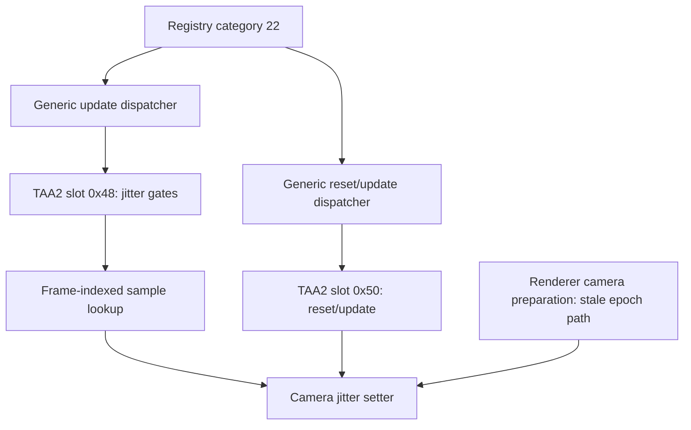

# Native jitter assignment and callback map

Updated 2026-09-23. The [bare-profile control](jitter-bare-profile.md) establishes
that the sampled zero state does not require the configured mods or bridge.
This offline follow-up identifies the native dispatch and reset paths needed
for an execution-time observation. It does **not** identify the writer that
changed the sampled TAA2 jitter-enable byte to zero.

The user subsequently reported no deliberate camera movement during the tests.
Record these as stationary-input observations, not a controlled motion test.
This is user-reported context; camera input was not instrumented, and scene
animation or automatic camera changes can still occur. Do not infer motion
vector correctness from these runs.

## Identity and evidence scope

Host version `0.0.0.0`, SHA-256
`C2EBBBD2C49F216D484E31A5219BED419EB1E5E7D206D02CBA040A3AB79D90EA`.
Decoded comparison SHA-256
`D78611731E4A5F214E306D1D577D4782B59ADAF1C75DE54D2983CAA45074884C`;
PE timestamp `0x66D13CB6`, image size `0x55D3000`.
Addresses below are image-relative RVAs for that identity.

Private evidence is under `local/jitter-native-assignment-20260923/`.
`verify_map.py` rechecks both image hashes and produces `static-map.json` with
16 reviewed code spans, five instruction assertions and three vtable mappings.
The frame-index arithmetic was checked against 10,151 values, including large
unsigned values. New spans have not been compared with a live process yet.
No runtime deployment, configuration or native implementation changed.

Reference searches cover selected RIP-relative mov/lea forms and direct calls
whose boundaries can be validated from unwind entries. They are not exhaustive
data-flow or writer searches. Some functions have multiple unwind ranges;
bounded prefixes and reviewed combined ranges are labeled in the manifest.

## Defaults and type distinctions

Both the single TAA2 constructor at `0x2391320` and array construction path at
`0x2391210` initialize the four bytes starting at object `+0x184` with
`0x01010001`: jitter enabled, reset disabled byte zero, velocity and sharpening
bytes one. The array path uses an adjusted pointer at object `+0x178`, so its
store appears as `[rbx+0xC]`, not a literal `+0x184` store.

The property registration at `0x2391830` binds the name `mJitterEnable` to
the exact object's `+0x184` address. An indirect property assignment could
therefore write the byte without a literal `0x184` displacement in its own code.
No such writer has yet been tied to the live sampled instance. Scene-property
presence bytes remain distinct from values; see the [startup map](jitter-startup-control.md).

The image contains three separate TAA classes. Do not use the same field
interpretation for all three:

| Class | Vtable | Jitter slot `+0x48` | Reset/update slot `+0x50` | Render slot `+0x60` |
| --- | --- | --- | --- | --- |
| `uTemporalAAFilter` | `0x354DD78` | `0x2596090` | `0x2596100` | `0x2595550` |
| `uTemporalAAFilter2` | `0x351BDA8` | `0x23931E0` | `0x2393260` | `0x2392150` |
| `uTemporalAAFilter3` | `0x354DF48` | `0x25979B0` | `0x2597A30` | `0x2597870` |

For example, the first class exposes `mJitterEnable` at `+0x1B4`; TAA3 has
a different layout and a frame-parity jitter callback. Existing controls only
interpret the exact TAA2 vtable. This static table does not establish that the
other classes were instantiated or active in those runs.

## Dispatch path

The registry's category-list head is `manager + 0x80 + category * 0xF8`.
The previously traversed `+0x15D0` head corresponds to category 22.
Category update `0x221ACE0` reaches `0x2228F50` either directly in its list
loop or through queued records containing that callback address. Category
reset/update `0x221B400` similarly reaches `0x2228F20`.

`0x2228F50` first calls unit vtable slot `+0xE8`, then dispatches `+0x48` if:

- object word `+0xC` equals 8;
- object flags `+0x14` contain bit 0;
- `(object_mask_at_0x40 & ~manager_mask_at_0x4A48) == 0`.

`0x2228F20` applies the same three gates and tail-dispatches slot `+0x50`.
The generic update counter at object `+0x2C` increments even if the later
`+0x48` gate fails; that counter alone would not prove jitter callback execution.
Names such as "type 8" in older scalar reports describe the captured word,
not RTTI identity; the vtable is the type guard used here.

These arrows are static call or dispatch relationships. They do not establish
the order in which categories, queued work and rendering executed in a capture.

## Sample selection and clearing

After the reviewed TAA2 callback's view, blend, object and jitter-enable gates
pass, `0x227DB60` selects the address:

`table + 0xE6A0 + 8 * (renderer_frame_counter % 20)`.

The selector reads renderer `+0x1F210`. It does not read camera movement or
input. The reviewed callback also has no direct movement test. Thus deliberate
movement is not a prerequisite in this part of the path. An upstream writer
of the enable byte could still have additional conditions; that remains open.
The table contents and their effect on raster projection remain unqualified.

Camera setter `0x228F390` copies the incoming eight bytes to camera `+0x38`
and records renderer `+0x1F208` in camera `+0x40`.

The renderer preparation prefix at `0x229A080` contains a second relevant path:
when view bit `0x800000` is clear, it compares camera `+0x40` to the renderer
epoch. A mismatch calls the setter with vector `0x503C3E8`, previously observed
as zero, before camera vtable `+0x48` is invoked. This vector is not backed by
raw bytes in the decoded file; its prior live value is not an immutable constant.
The view-bit-set branch selects another path and must be recorded separately.

TAA2's reset/update callback can also supply that vector when renderer
`+0x1F560` is nonzero. Neither reviewed clearing path writes TAA2 `+0x184`.
They can explain a zero **stored jitter value** under their conditions, but
do not explain the observed zero **enable byte**.

## Next observation contract

The next diagnostic should record actual TAA2 callback entry/exit and the
camera-jitter setter, while forwarding original calls and preserving results.
It should operate with DLSS Off without requiring a bridge Create/Evaluate.
The offline pass itself did not install hooks. The subsequent
[callback recorder implementation](../runtime/jitter-callback-recorder.md)
implements this observation contract with owned fixture verification.
[Run 37452](native-jitter-callback-result.md) now adds separate game evidence
for callback execution and sampled update/reset/setter order across menu,
still and user-reported pan windows. The enable-byte writer and GPU/raster
effect remain open; the result does not broaden the static map's own scope.

For any implementation, use the native Windows x64 ABI: the reviewed TAA2
callbacks take the object in RCX; the setter takes camera in RCX and a pointer
to the eight-byte input in RDX. Treat return values as unqualified until the
wrapper/fixture verifies preservation; do not infer an ABI from a C++ name.
Validate the pinned image, live code spans, vtables and readable scalar ranges
before admission. Never retain or acquire ownership of game objects.

Use explicit bounded capture windows, scalar copies, per-thread ordering,
entry/exit markers, loss counts and a hard record cap. Capture the object/type,
view and callback gates, generic masks, frame/epoch, setter input and camera
values. A setter caller address alone is insufficient attribution: some paths
tail-call it. Relate calls using callback context and thread identity, and do
not describe callback forwarding as zero perturbation.

One future loaded-scene comparison should include a still interval followed
by a deliberate camera pan, separately marked. This adds the missing motion
condition without repeating the unchanged isolation controls. Stop on an
identity mismatch, ambiguous type or exhausted budget. Before deployment,
verify original-call preservation, bounded concurrency and hook removal with
owned fixtures; document the exact destination backup and rollback.

At the end of this offline pass, the enable-byte writer, actually dispatched
object, runtime callback/reset order and GPU/raster effect were open. Run 37452
subsequently identifies the sampled TAA2 objects and callback order. The writer
and GPU/raster effect remain unresolved; neither result establishes broken
native TAA or justifies forcing jitter.
